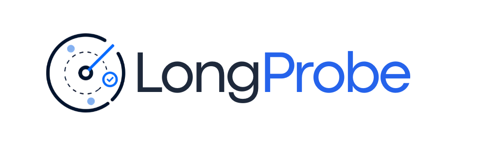

<p align="center">
  
</p>

<p align="center">
  <strong>Sub-second RAG regression testing for production pipelines</strong>
</p>

<p align="center">
  <a href="https://pypi.org/project/longprobe/"></a>
  <a href="https://pepy.tech/projects/longprobe"></a>
  <a href="https://pypi.org/project/longprobe/"></a>
  <a href="https://opensource.org/licenses/MIT"></a>
  <a href="https://github.com/ENDEVSOLS/LongProbe/actions/workflows/ci.yml"></a>
  <a href="https://endevsols.github.io/LongProbe"></a>
</p>

<p align="center">
  <a href="https://github.com/ENDEVSOLS/LongProbe/tree/main/examples/rag-regression-starter"><strong>Run the Starter Kit</strong></a> •
  <a href="#quick-start">Quick Start</a> •
  <a href="https://endevsols.github.io/LongProbe">Documentation</a> •
  <a href="#python-api">Python API</a> •
  <a href="#github-actions">CI/CD</a>
</p>

---

## Overview

> "Did my last commit break retrieval?" — now you know in seconds.

LongProbe is a **sub-second RAG regression harness**. Define your Golden Questions once, run `longprobe check` on every commit, and get an exact diff of which document chunks were lost in your latest change — before your users notice.

**Think `pytest --watch` for your RAG pipeline.**

## 🎬 Demos

### Complete Workflow

Review golden evidence, save a trusted baseline, and detect missing evidence with a Before / After / Change results table.


### Monitor RAG Quality

Inspect recall percentages, evidence found / required, and quality results: two passing questions and one deliberate failure.


### Detect Regressions

Compare against an explicitly selected baseline, check compatibility, and identify lost evidence and regression counts.


## Why LongProbe?

Every RAG developer faces the same silent killer: you refactor chunking strategy, upgrade LangChain, or add a new document — and your retrieval silently degrades. DeepEval and RAGChecker are heavyweight evaluation frameworks meant for batch analysis, not fast regression checks in a dev loop.

**LongProbe gives you instant feedback:**

- ⚡ **Sub-second checks** on small golden sets
- 🔍 **Exact diffs** showing which chunks were lost/gained
- 📊 **Recall scores** with per-question breakdown
- 💾 **Baseline tracking** to catch regressions over time
- 🧪 **pytest integration** for existing test suites
- 🔌 **Pluggable adapters** for any vector store

## Features

- ⚡ **Sub-second checks** on small golden sets
- 📋 **Golden Questions + Required Chunks** defined in simple YAML
- 🎯 **Strict Top-K enforcement**: evaluates only the top-K ranked results and records `returned_count` and `evaluated_count`
- 🔍 **Three match modes**: exact ID, text substring, and lexical cosine similarity (`semantic` mode)
- 📊 **Recall Score** with per-question breakdown
- 🔄 **Regression diff**: exactly which chunks were lost/gained
- 💾 **SQLite baseline store**: explicitly save references and compare compatible runs
- 🔒 **Privacy-first CI reporting**: shared PR comments, annotations, and default JSON artifacts redact raw document evidence by default
- 🛡️ **Strict HTTP validation**: separates genuine empty retrieval results from malformed payloads or transport errors
- 🧪 **pytest plugin**: integrate into existing test suites
- 🔌 **Pluggable adapters**: HTTP API, Chroma, LangChain, LlamaIndex, Pinecone, Qdrant
- 🖥️ **Beautiful CLI** with Rich tables, JSON, and GitHub Actions output
- 👀 **Watch mode**: auto re-run when the golden file changes
- 🏗️ **CI/CD ready**: fails pipeline on regression

## Quick Start

> 🚀 **Want to try LongProbe in 30 seconds?** Run the [**RAG Regression Starter Kit**](https://github.com/ENDEVSOLS/LongProbe/tree/main/examples/rag-regression-starter) with 20 pre-built golden questions and an offline `Pass → Fail → Fix` demo (zero API keys required).

### Installation

Requires **Python 3.11 or newer**. The package-index commands below install a published version. To use this v0.2.0 checkout, run `pip install -e .` from the directory containing `pyproject.toml`, or install its locally built wheel. See [installation and verified support matrix](https://github.com/ENDEVSOLS/LongProbe/blob/main/docs/getting-started/installation.md).

```bash
# Install with UV (recommended)
uv pip install longprobe

# Install with pip
pip install longprobe

# Install with optional dependencies
uv pip install "longprobe[chroma]"      # ChromaDB support
uv pip install "longprobe[openai]"      # Optional OpenAI SDK
uv pip install "longprobe[all]"         # Everything
```

### Initialize

```bash
longprobe init
```

This creates:

- `.longprobe/` — directory for baseline storage
- `goldens.yaml` — example golden questions
- `longprobe.yaml` — configuration file

The initial content is copied from fixed templates in CLI source. It does not read your documents or embeddings. Replace example questions with verified cases, or use `capture`/`generate --auto-capture` and review drafts with `edit`.

Configuration errors and zero-question evaluations fail explicitly. Existing invalid golden files are preserved rather than replaced during generation. See the [working local HTTP quick start](https://github.com/ENDEVSOLS/LongProbe/blob/main/docs/getting-started/quick-start.md) and [v0.2.0 migration notes](https://github.com/ENDEVSOLS/LongProbe/blob/main/docs/releases/v0.2.0.md).

### Define Golden Questions

Edit `goldens.yaml` with reviewed test cases. Omitted status defaults to `approved`; use `status: draft` for unverified candidates. Drafts are excluded by default. See the [golden-question review workflow](https://github.com/ENDEVSOLS/LongProbe/blob/main/docs/guide/golden-questions.md).

```yaml
name: "my-rag-golden-set"
version: "1.0"

questions:
  - id: "q1"
    question: "What is the termination clause?"
    match_mode: "id"            # exact chunk ID match
    required_chunks:
      - "contracts_chunk_42"
      - "contracts_chunk_43"
    top_k: 5
    tags: ["contracts", "critical"]

  - id: "q2"
    question: "What are the payment terms?"
    match_mode: "text"          # substring match
    required_chunks:
      - "net 30 days from invoice"
    top_k: 5

  - id: "q3"
    question: "Who can sign contracts?"
    match_mode: "semantic"      # word-frequency similarity
    semantic_threshold: 0.80
    required_chunks:
      - "The following officers are authorized to sign"
    top_k: 10
```

### Configure Your Retriever

Edit `longprobe.yaml`:

```yaml
retriever:
  type: "chroma"
  persist_directory: "./chroma_db"
  collection: "my_documents"

scoring:
  recall_threshold: 0.8
  fail_on_regression: true

baseline:
  db_path: ".longprobe/baselines.db"
  auto_compare: true
  quality_gate: all_questions
```

### Run Checks

```bash
# Run against live vector store
longprobe check --goldens goldens.yaml

# Override settings
longprobe check --threshold 0.9 --top-k 10

# After saving v1.0, require that reference
longprobe check --baseline v1.0

# Inspect current quality without a historical comparison
longprobe check --no-compare

# JSON output for automation
longprobe check --output json

# GitHub Actions annotations
longprobe check --output github
```

## CLI Reference

### Core Commands

| Command                     | Description                                                        |
| :-------------------------- | :----------------------------------------------------------------- |
| `longprobe init`            | Create starter configuration files                                 |
| `longprobe check`           | Run probes against the golden set                                  |
| `longprobe diff`            | Compare current results against baseline                           |
| `longprobe baseline save`   | Fresh approved-only evaluation and policy-gated baseline promotion |
| `longprobe report PATH`     | Render a saved JSON report without retrieval                       |
| `longprobe baseline list`   | List all saved baselines                                           |
| `longprobe watch`           | Watch golden file and re-run on changes                            |
| `longprobe generate`        | Auto-generate Golden Questions from documents                      |
| `longprobe capture`         | Capture candidate evidence from your retriever                     |
| `longprobe edit`            | Review and approve draft questions                                 |

### Examples

```bash
# Initialize project
longprobe init

# Run checks with custom config
longprobe check -g goldens.yaml -c longprobe.yaml

# Save baseline for comparison
longprobe baseline save --label v1.0

# Compare against baseline
longprobe diff --baseline v1.0

# Watch mode for development
longprobe watch --interval 2

# Generate questions from documents
longprobe generate ./docs --auto-capture
longprobe edit
```

## Python API

### Basic Usage

```python
from longprobe import LongProbe
from longprobe.adapters import create_adapter

# Create adapter for your vector store
adapter = create_adapter(
    "chroma",
    collection_name="my_documents",
    persist_directory="./chroma_db"
)

# Create and run probe
probe = LongProbe(
    adapter=adapter,
    goldens_path="goldens.yaml",
    config_path="longprobe.yaml"
)
report = probe.run()

print(f"Overall Recall: {report.overall_recall:.2%}")
print(f"Pass Rate: {report.pass_rate:.2%}")
```

### Baseline Management

```python
from longprobe import LongProbe
from longprobe.adapters import create_adapter

adapter = create_adapter("chroma", collection_name="docs", persist_directory="./db")
probe = LongProbe(adapter=adapter, goldens_path="goldens.yaml")

# Run and save baseline
report = probe.run()
probe.save_baseline(label="v1.0")

# After making changes, evaluate against the explicitly selected reference.
report2 = probe.run(baseline_label="v1.0")
diff = report2.comparison
print(f"Regressions: {len(diff['regressions'])}")
print(f"Improvements: {len(diff['improvements'])}")
assert report2.quality["passed"], report2.quality["reasons"]
```

### With LangChain

```python
from longprobe import LongProbe
from longprobe.adapters import LangChainRetrieverAdapter

# Wrap your existing LangChain retriever
adapter = LangChainRetrieverAdapter(your_langchain_retriever)
probe = LongProbe(adapter=adapter, goldens_path="goldens.yaml")
report = probe.run()

assert report.quality["passed"], report.quality["reasons"]
```

### With LlamaIndex

```python
from longprobe import LongProbe
from longprobe.adapters import LlamaIndexRetrieverAdapter

adapter = LlamaIndexRetrieverAdapter(your_llamaindex_retriever)
probe = LongProbe(adapter=adapter, goldens_path="goldens.yaml")
report = probe.run()
```

## Pytest Integration

### Configuration

Configure the retriever, scoring, and baseline settings in `longprobe.yaml`. The installed plugin supplies `longprobe_report`, which evaluates once per pytest session and shares the result across tests.

```bash
pytest --longprobe-config tests/longprobe.yaml --longprobe-goldens tests/goldens.yaml
```

### Writing Tests

```python
def test_retrieval_quality(longprobe_report):
    assert longprobe_report.quality["passed"], longprobe_report.quality["reasons"]
```

Alternatively, use `pytest --longprobe-fail-threshold 0.85` to enforce quality automatically, even when tests do not request the report. Explicit per-question thresholds take precedence over that global threshold. Without an assertion or enforcement option, requesting a report alone does not enforce passing quality.

## Retriever Adapters

LongProbe supports multiple vector stores and retrieval frameworks:

| Adapter              | Type         | Configuration                  |
| :------------------- | :----------- | :----------------------------- |
| **ChromaDB**         | Direct       | `type: chroma`                 |
| **Pinecone**         | Direct       | `type: pinecone`               |
| **Qdrant**           | Direct       | `type: qdrant`                 |
| **HTTP API**         | Direct       | `type: http`                   |
| **LangChain**        | Programmatic | `LangChainRetrieverAdapter`    |
| **LlamaIndex**       | Programmatic | `LlamaIndexRetrieverAdapter`   |

### ChromaDB Example

```yaml
retriever:
  type: chroma
  collection: my_collection
  persist_directory: ./chroma_db
```

### HTTP API Example

```yaml
retriever:
  type: http
  http:
    url: "http://localhost:8000/api/retrieve"
    method: "POST"
    body_template: '{"query": "{question}"}'
    response_mapping:
      results_path: "data.chunks"
      text_field: "content"
```

## GitHub Actions

```yaml
name: RAG Regression Check

on: [push, pull_request]

jobs:
  rag-probe:
    runs-on: ubuntu-latest
    steps:
      - uses: actions/checkout@v4
      - uses: astral-sh/setup-uv@v4
      - run: uv pip install --system "longprobe[chroma]==0.2.0"
      - name: Run RAG regression check
        run: longprobe check --goldens goldens.yaml --output github
```

## Match Modes

### ID Match (`match_mode: "id"`)

Exact string match on chunk/document IDs. Best when you control the IDs in your vector store.

### Text Match (`match_mode: "text"`)

Case-insensitive substring matching. Checks if the required text appears anywhere in the retrieved documents.

### Semantic Match (`match_mode: "semantic"`)

Word-frequency cosine similarity. Measures lexical overlap; it does not use neural embeddings or guarantee matching paraphrases.

## Current limitations

Normal checks pass text directly to the retriever; `embedder` settings are not wired into this path. Pinecone/Qdrant need an embedding-aware custom adapter or application endpoint. Semantic matching uses word frequencies, not neural embeddings. CLI/Python baseline promotion now defaults to every evaluated question passing. Legacy references remain readable but require reviewed rebaselining for strict comparison. JSON is machine-readable, and the pytest plugin supports configured adapters and a shared report fixture. Explain does not add rank/distance deltas.

## Development

```bash
# Install for development
git clone https://github.com/ENDEVSOLS/LongProbe.git
cd LongProbe
uv sync --dev

# Run tests
uv run pytest tests/unit/ -v
uv run pytest tests/ -v --run-integration

# Lint and format
uv run ruff check src/
uv run ruff format src/
```

## How It Works

```
Reviewed golden questions
            ↓
     Retriever adapter
            ↓
       Recall scoring
            ↓
    Baseline comparison
            ↓
  Quality verdict + report
```

1. **Define** your Golden Questions + Required Fact Chunks in YAML
2. **Configure** your existing retriever; it manages text-to-vector conversion where supported
3. **Retrieve** from your live vector store using the pluggable adapter
4. **Score** each question by checking if required chunks appear in Top-K results
5. **Compare** against saved baselines to detect regressions
6. **Report** a Recall Score, diff of lost chunks, and optionally fail CI/CD

---

## Part of the Long Suite

LongProbe is part of the **Long Suite** — a collection of tools for building, testing, and monitoring production RAG systems.

| Project | Description |
|---|---|
| **[LongParser](https://github.com/ENDEVSOLS/LongParser)** | Document ingestion and chunking |
| **[LongTrainer](https://github.com/ENDEVSOLS/Long-Trainer)** | RAG chatbot framework |
| **[LongGuard](https://github.com/ENDEVSOLS/LongGuard)** | In-flight circuit breaker and reasoning loop recovery for agents |
| **[LongCache](https://github.com/ENDEVSOLS/LongCache)** | Semantic similarity cache for LLM and RAG pipelines |
| **[LongTracer](https://github.com/ENDEVSOLS/LongTracer)** | Hallucination detection and tracing |
| **[LongProbe](https://github.com/ENDEVSOLS/LongProbe)** | Retrieval regression testing *(you are here)* |

---

## Contributing

We welcome contributions! Please see [CONTRIBUTING.md](https://github.com/ENDEVSOLS/LongProbe/blob/main/CONTRIBUTING.md) for guidelines.

## Security

For security issues, please see [SECURITY.md](https://github.com/ENDEVSOLS/LongProbe/blob/main/SECURITY.md).

## License

MIT License — see [LICENSE](https://github.com/ENDEVSOLS/LongProbe/blob/main/LICENSE) for details.

---

### Need help with production RAG retrieval?

[Book a free AI reliability check](https://endevsols.com/ai-reliability-check?utm_source=github&utm_medium=referral&utm_campaign=longprobe_reliability&utm_content=readme_footer)
to discuss missing retrieval evidence, baseline setup, or CI integration with EnDevSols.

---

<p align="center">
  <a href="https://endevsols.com">Website</a> •
  <a href="https://github.com/ENDEVSOLS/LongProbe">GitHub</a> •
  <a href="https://endevsols.github.io/LongProbe">Documentation</a>
</p>
