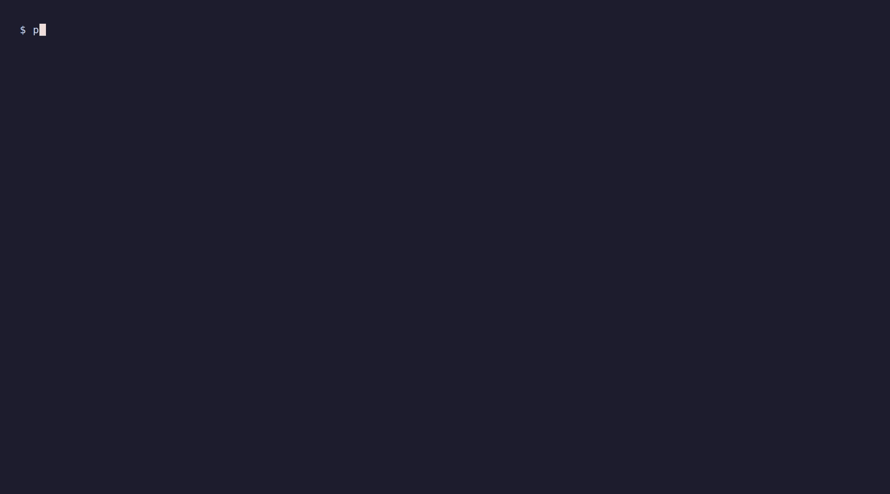

# Monitor RAG quality



The v0.2.0 dashboard shows one evaluation with per-question recall, required evidence found, pass/fail results, and the shared quality verdict. It also shows that no historical comparison occurred when a baseline is absent. Progress panels and result tables are displayed without source code.

Evidence is displayed as **found / required**, alongside recall percentage and PASS/FAIL. For example, **0 / 1** means zero of one required items was retrieved, giving **0% recall**. Similarity scores are not correctness percentages and are not displayed by this synthetic demonstration.

## Run locally

From the repository root:

```bash
make setup-demos
demos/.recording_venv/bin/python demo_run/monitor_rag_quality.py
```

The script uses three reviewed sample cases, an 85% threshold, and a deterministic in-memory adapter. Refund evidence is deliberately omitted: two questions pass and one fails. Overall recall and pass rate are 66.7%, and the quality summary identifies the missing evidence. This is an expected demonstration failure; the script verifies it and exits successfully. It runs without an external service or optional vector SDK. Temporary files are removed after each run. Add `--no-delay` for immediate output.

## Inspect the verdict

```python
report = probe.run()
print(f"Overall recall: {report.overall_recall:.1%}")
print(f"Pass rate: {report.pass_rate:.1%}")
print(report.baseline_identity)
assert report.quality["passed"], report.quality["reasons"]
```

A strong average can hide a failed question. Use the shared quality verdict to enforce each selected question's effective threshold and any available comparison. Passing does not automatically approve questions or save a baseline.

The fixture demonstrates evaluation behavior rather than live production monitoring. To evaluate your own application, supply its retriever and reviewed goldens. See the [Python guide](../guide/python-api.md) and [pytest integration](../integrations/pytest.md).

Regenerate the GIF with `make demos` after installing the recording tools listed in `demos/README.md`.
